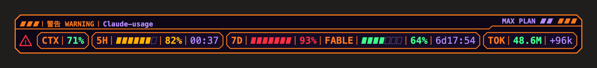
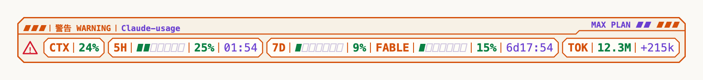

# Claude usage meter

A Claude Code mod that shows your usage in a band above the prompt, styled like a console readout.


Readouts turn amber at 75% and red at 90%:



There is a daylight skin for light mode:



(The pictures are the mod's own drawing with sample numbers. The ◐ button is drawn by the app, so it may sit a little differently there.)

- **CTX**: how full this session's context window is.
- **5H / 7D**: how much of your 5-hour and 7-day plan limits you have used, with a bar that turns amber at 75% and red at 90%, and a countdown to each reset. The figures come from the session, and every 5 minutes from Anthropic's account usage endpoint, so they keep up with usage elsewhere while this session sits idle.
- **FABLE** (and other per-model weekly limits): read from Anthropic's account usage endpoint with the session's own sign-in, refreshed every 5 minutes. A limit that resets at the same moment as 7D shares its chip and countdown.
- **TOK**: tokens this session has used since the mod loaded, plus the last turn's tokens.

In the desktop app the band is drawn as one picture with octagon frames; in a terminal it is a single text line. Run `/usage-meter` to hide or show it.

The plan name in the header's right corner is the mod's `plan` option (empty by default, so none is shown), since Claude Code does not tell mods which plan you are on. Set it when installing with `--config plan="MAX PLAN"`, later with `/plugin configure usage-meter@claude-usage-mod`, or in `~/.claude/settings.json`:

```json
{ "pluginConfigs": { "usage-meter@claude-usage-mod": { "options": { "plan": "MAX PLAN" } } } }
```

The `skin` option picks the look: `auto` (the default) follows light or dark mode where the surface lets the drawing see it and is otherwise dark, `dark` is the violet console, `light` is the daylight one. In the desktop app the small ◐ button in the band's top-left corner flips between dark and light, and the pick is remembered.

## Skill hints

After you send a message, a small model (Haiku) checks it against your installed skills. If one plainly fits, a line appears under the band: `💡 可以用 /skill-name`, a short reason, **用呢個** and ✕.

- **用呢個** asks Claude to run that skill on your last message. If Claude is busy, it waits its turn.
- ✕ dismisses the hint. It also goes when you send another message or the skill runs.
- Slash commands and messages under 8 characters are not checked.

Each check uses a little of your usage. To turn hints off, set the `skillHints` option to `false`:

```json
{ "pluginConfigs": { "usage-meter@claude-usage-mod": { "options": { "skillHints": false } } } }
```

## Install

At the prompt of a terminal session:

```
/plugin install usage-meter --marketplace whatsphone-creator/claude-usage-mod
```

Answer `y` to add the marketplace, then choose a scope.

From a shell:

```
claude plugin install usage-meter --marketplace whatsphone-creator/claude-usage-mod
```

Add `--config plan="MAX PLAN"` or `--config skin=light` to set an option as you install.

In the desktop app, where `/plugin` does not run: click + next to the prompt box, then Plugins, Add marketplace with `whatsphone-creator/claude-usage-mod`, then Add plugin.
