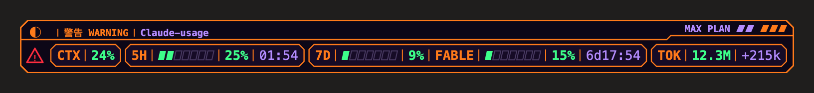

# Claude usage meter

A Claude Code mod that shows your usage in a band above the prompt, styled like a console readout.



Readouts turn amber at 75% and red at 90%:


There is a daylight skin for light mode:


(The pictures are the mod's own drawing with sample numbers.)

- **CTX**: how full this session's context window is.
- **5H / 7D**: how much of your 5-hour and 7-day plan limits you have used, with a bar that turns amber at 75% and red at 90%, and a countdown to each reset.
- **FABLE** (and other per-model weekly limits): read from Anthropic's account usage endpoint with the session's own sign-in, refreshed every 5 minutes. A limit that resets at the same moment as 7D shares its chip and countdown.
- **TOK**: tokens this session has used since the mod loaded, plus the last turn's tokens.

In the desktop app the band is drawn as one picture with octagon frames; in a terminal it is a single text line. Run `/usage-meter` to hide or show it.

The plan name in the header's right corner is the mod's `plan` option (empty by default, so none is shown), since Claude Code does not tell mods which plan you are on. Set it in `/config`, or in `~/.claude/settings.json`:

```json
{ "pluginConfigs": { "usage-meter": { "options": { "plan": "MAX PLAN" } } } }
```

The `skin` option picks the look: `auto` (the default) follows light or dark mode where the surface lets the drawing see it and is otherwise dark, `dark` is the violet console, `light` is the daylight one. In the desktop app the small ◐ button in the band's top-left corner flips between dark and light, and the pick is remembered.

## Install

At the prompt of a terminal session:

```
/plugin install usage-meter --marketplace whatsphone-creator/claude-usage-mod
```

Answer `y` to add the marketplace, then choose a scope.

From a shell:

```
claude plugin install usage-meter --marketplace whatsphone-creator/claude-usage-mod
```

In the desktop app, where `/plugin` does not run: click + next to the prompt box, then Plugins, Add marketplace with `whatsphone-creator/claude-usage-mod`, then Add plugin.
